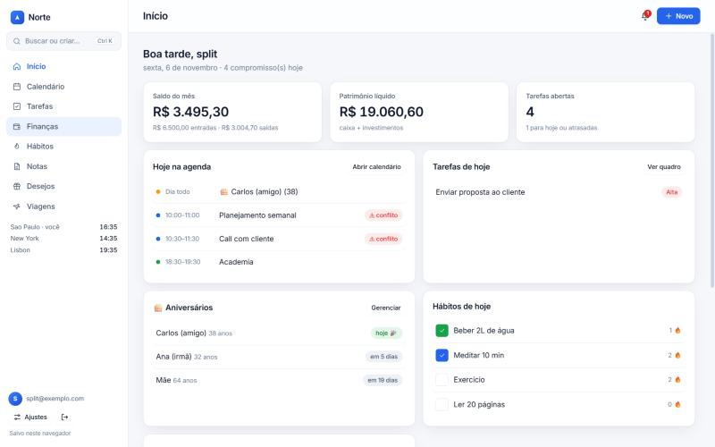
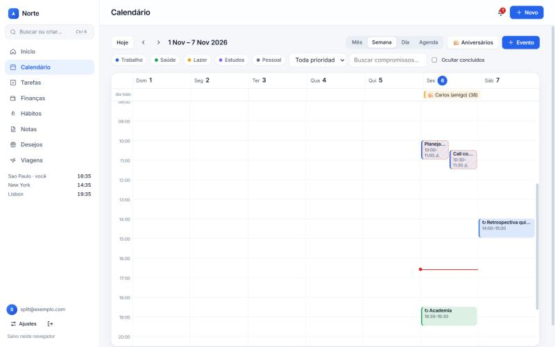
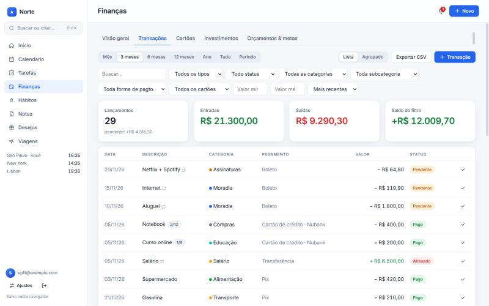
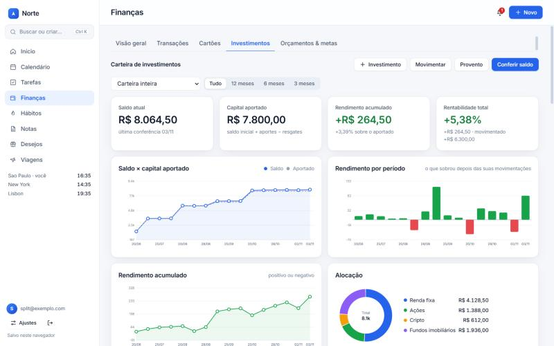
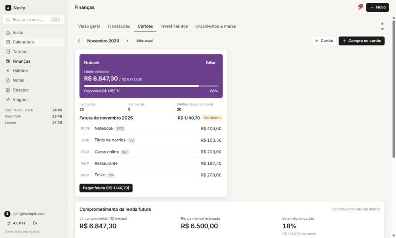
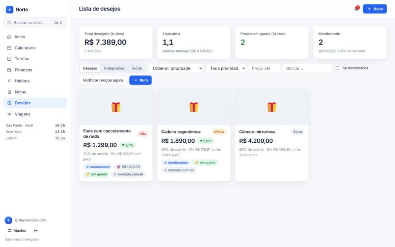
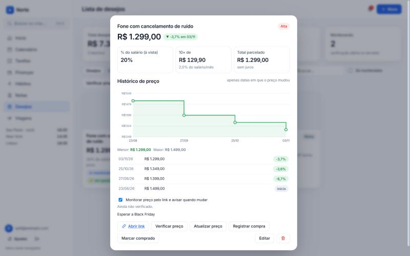
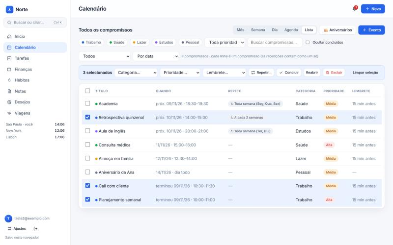
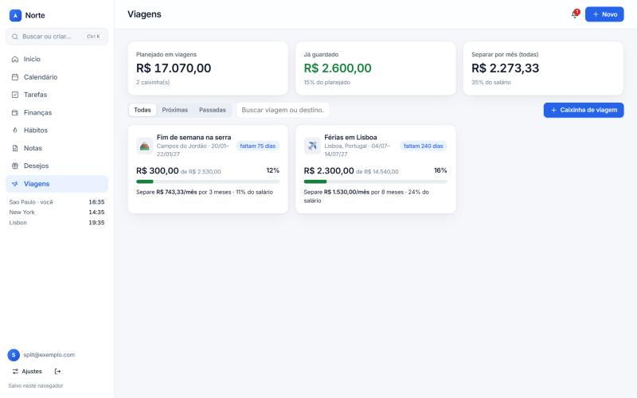
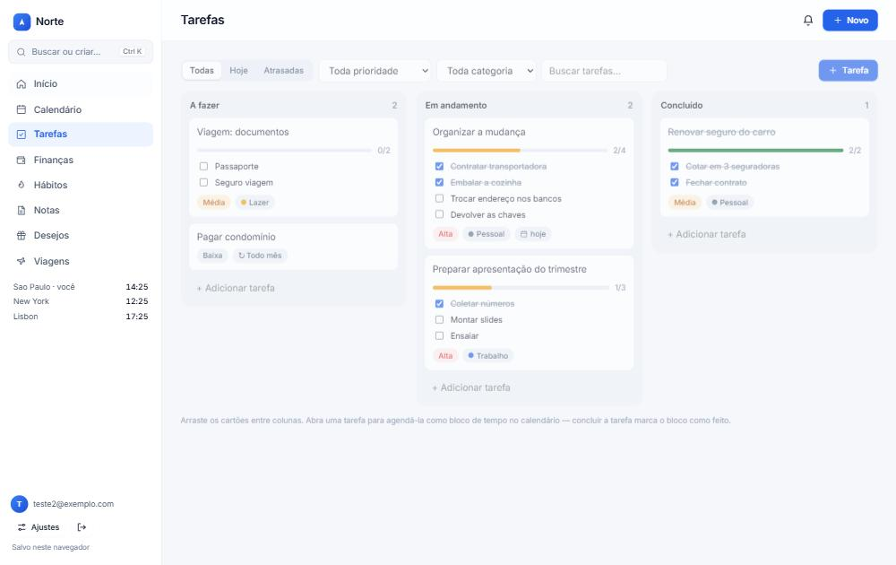

<div align="center">

# Sistema de planejamento pessoal

**Organização pessoal all-in-one: calendário, finanças, tarefas, hábitos, notas, lista de desejos, viagens e aniversários — num só lugar.**

[](LICENSE)




</div>

---

## Sumário

- [Visão geral](#visão-geral)
- [Capturas de tela](#capturas-de-tela)
- [Recursos](#recursos)
- [Criar por texto (Ctrl+K)](#criar-por-texto-ctrlk)
- [Atalhos de teclado](#atalhos-de-teclado)
- [Stack e decisões de projeto](#stack-e-decisões-de-projeto)
- [Arquitetura](#arquitetura)
- [Estrutura do repositório](#estrutura-do-repositório)
- [Variáveis de ambiente](#variáveis-de-ambiente)
- [Rodar localmente](#rodar-localmente)
- [Modelo de dados](#modelo-de-dados)
- [Segurança e privacidade](#segurança-e-privacidade)
- [Limitações conhecidas](#limitações-conhecidas)
- [Roadmap](#roadmap)
- [Contribuindo](#contribuindo)
- [Licença](#licença)

---

## Visão geral

O Norte reúne em uma interface limpa e rápida (inspirada em Notion, Linear e Raycast) tudo o que costuma ficar espalhado em vários aplicativos:
https://planejamento-pessoal-blush.vercel.app
| Área | O que resolve |
|---|---|
| **Calendário** | Agenda com arrastar e soltar, conflitos, recorrências complexas, fusos horários e lembretes |
| **Finanças** | Fluxo de caixa, cartões com fatura e parcelamento, investimentos, orçamentos e metas |
| **Tarefas** | Kanban sincronizado com blocos de tempo no calendário |
| **Hábitos** | Sequências, aderência e mapa de consistência |
| **Notas** | Markdown, vínculo com eventos e transações, gravação e resumo de reuniões |
| **Desejos** | Itens que você quer comprar, com peso no salário, parcelas com juros e monitor de preço |
| **Viagens** | Caixinhas que calculam quanto separar por mês até a data da viagem |
| **Aniversários** | Aparecem todo ano no calendário e avisam no dia com 🎂 |

Cada usuário tem **login próprio e dados isolados** (Supabase com Row Level Security). Sem Supabase configurado, o app roda em **modo local** (contas e dados só no navegador), ótimo para testar.

Não há framework nem etapa de build de front-end: são arquivos estáticos organizados por responsabilidade, simples de ler, alterar e publicar.

## Capturas de tela

> As imagens usam os dados de exemplo (*Ajustes → Carregar dados de exemplo*).

| Calendário (semana, conflitos, filtros e 🎂) | Transações (período, filtros e agrupamento) |
|---|---|
|  |  |

| Investimentos: saldo × aportado, rendimento por período | Cartões, fatura e limite |
|---|---|
|  |  |

| Lista de desejos | Histórico de preço (só datas em que mudou) |
|---|---|
|  |  |

| Lista de compromissos com ações em massa | Caixinhas de viagem |
|---|---|
|  |  |

| Tarefas com subtarefas e repetição | Página inicial |
|---|---|
|  |  |

## Recursos

### Calendário e gestão de tempo

- **Visões:** mês, semana, dia, agenda por dia e **Lista** de todos os compromissos.
- **Lista com seleção e ações em massa:** marque vários compromissos e altere de uma vez a **categoria**, a **prioridade**, o **lembrete** e a **repetição** (ou conclua, reabra e exclua). Dá para filtrar por próximos, passados, que se repetem ou concluídos, ordenar por data, título, categoria ou prioridade, e combinar com os filtros de categoria, prioridade e busca.
- **Arrastar e soltar:** mova compromissos entre horários e dias (passos de 15 min) e **redimensione** o bloco pela borda inferior. `Esc` cancela o arrasto.
- **Sobreposição permitida:** compromissos no mesmo horário são aceitos normalmente e aparecem lado a lado. O sistema só sinaliza, com um contorno âmbar e a indicação “ao mesmo tempo que…”, ao criar, mover ou agendar.
- **Recorrências:** diária, semanal (inclusive “toda terça e quinta”), quinzenal (semanal a cada 2), mensal e anual, com intervalo e data final, além da opção **Personalizado** (a cada N dias, semanas, meses ou anos). O mesmo seletor vale para tarefas e para a repetição em massa na Lista. Ao arrastar uma ocorrência o sistema pergunta se vale só para ela (cria uma exceção) ou para a série toda.
- **Fusos horários:** cada compromisso tem seu fuso; a exibição usa o seu fuso, e você pode (opcionalmente) adicionar relógios extras de outros fusos em Ajustes.
- **Lembretes:** de 0 min a 1 dia antes, com central de notificações no app e alertas do navegador.
- **Detalhes do compromisso:** prioridade (alta, média, baixa), categorias coloridas (Trabalho, Saúde, Lazer, Estudos, Pessoal), subtarefas, links e anexos por URL, dia inteiro.
- **Aniversários 🎂:** cadastro no botão do calendário. Aparecem todo ano como evento de dia inteiro (com a idade, se informar o ano), notificam **no dia** e, se quiser, 1, 3 ou 7 dias antes. No calendário (inclusive na visão em lista) há um filtro para mostrar, ocultar ou ver só aniversários.
- **Feriados 🎉:** feriados nacionais do Brasil (fixos e móveis, como Carnaval, Sexta-feira Santa e Corpus Christi) calculados sem depender de serviço externo. Aparecem no calendário e na visão em lista, e dá para ocultar pela caixa “Feriados”.
- **Exportação `.ics`:** compromissos e aniversários, compatível com Google Agenda, Apple Calendar e Outlook.

### Finanças

- **Painel:** entradas × saídas, despesas por categoria (rosca) e evolução patrimonial de 12 meses.
- **Dinheiro disponível × Investimentos × Patrimônio:** o dinheiro disponível já desconta o que foi para investimentos (e soma o que voltou em resgates), e as últimas movimentações aparecem logo abaixo, em fonte menor. O patrimônio é a soma do dinheiro disponível com os investimentos, sem contar o mesmo dinheiro duas vezes.
- **Transações:** entradas e saídas com categoria, subcategoria, forma de pagamento (cartão, Pix, débito, boleto, dinheiro, transferência) e status **pago, pendente ou atrasado** (calculado pela data). Lançamentos **recorrentes mensais** (a cada N meses, com data final) viram pendências automáticas; você pode pagar, editar ou pular um mês.
- **Ver todas, por período e com filtros:** mês, 3, 6 ou 12 meses, ano, **tudo** ou período personalizado; filtros por tipo, status, categoria, subcategoria, forma de pagamento, cartão, faixa de valor e busca por texto; ordenação por data, valor ou descrição. Um resumo mostra lançamentos, entradas, saídas e saldo do filtro.
- **Visão agrupada:** agrupe o resultado por categoria, subcategoria, descrição (onde você gastou), forma de pagamento, cartão, mês ou status, com participação percentual; clique numa linha para ver os lançamentos daquele grupo.
- **Cartões de crédito:** limite, dia de fechamento e vencimento, **melhor dia de compra**, fatura por mês e botão de pagar fatura.
- **Parcelamento:** a compra é dividida em até 60 parcelas, cada uma na fatura correta (compras após o fechamento caem na fatura seguinte). O **limite** é consumido pelas parcelas em aberto e liberado quando a fatura é paga; compras acima do limite pedem confirmação.
- **Comprometimento da renda futura:** gráfico de 12 meses com tudo que já está parcelado ou em fatura e o percentual da sua renda.
- **Investimentos pelo saldo conferido:** do mesmo jeito de uma planilha de acompanhamento. Você registra o **saldo** que vê no app do banco (*Conferir saldo*) e, quando você mesmo coloca ou tira dinheiro, registra a **movimentação** (aporte ou resgate). **Tudo o que não foi movimentação sua é rendimento**, positivo ou negativo. Mostra saldo × capital aportado, rendimento por período (barras verdes e vermelhas), rendimento acumulado, rentabilidade (método de Dietz modificado), histórico por conferência e alocação, por investimento ou pela carteira inteira, em 3, 6, 12 meses ou tudo. Proventos recebidos continuam à parte. Cada aporte ou resgate pode descontar do (ou creditar no) **dinheiro disponível** e, se você quiser, gerar também a transação correspondente; movimentações antigas podem ser marcadas como “no dinheiro” ou “fora do dinheiro” na lista de registros.
- **Orçamentos e metas:** teto por categoria com barra que fica **amarela em 80% e vermelha em 100%**; metas de economia mensal, anual (calculadas sozinhas) e por objetivo.
- **Exportação CSV** do período e dos filtros atuais (separador `;`, abre direto no Excel).

> As despesas no cartão entram no mês de **vencimento da fatura**, cada parcela no seu mês.

### Filtros e análises nas demais páginas

- **Visão geral:** fluxo de caixa em 6, 12 ou 24 meses e rosca de saídas ou de entradas por categoria.
- **Cartões:** filtro por cartão, que também acompanha o gráfico de comprometimento da renda futura.
- **Calendário:** filtros por categoria (em chips), prioridade, busca por texto e ocultar concluídos.
- **Tarefas:** filtros por prioridade, categoria e texto, além de Todas, Hoje e Atrasadas.
- **Desejos:** prioridade, preço máximo, texto e somente monitorados, além do status e da ordenação.
- **Viagens:** todas, próximas ou passadas, e busca por nome ou destino.
- **Notas:** ordenação (recentes, antigas, título) e filtro por com vínculo ou reuniões gravadas.
- **Hábitos:** gráfico de aderência em 30, 60 ou 90 dias.

### Tarefas, hábitos e notas

- **Kanban** (A fazer, Em andamento, Concluído) com arrastar e soltar, prioridades, categorias e prazos. Agende uma tarefa como **bloco no calendário**; concluir a tarefa marca o bloco como feito.
- **Reordenar subtarefas:** arraste as subtarefas, no cartão ou dentro da tarefa, para mudar a ordem.
- **Subtarefas:** cada tarefa pode ter uma lista de passos. Você edita o texto de cada passo dentro da tarefa (lápis no cartão) e marca direto no cartão do quadro, com barra de progresso (ex.: 2/4). Ao marcar o primeiro passo a tarefa vai para “Em andamento” e, quando o último é marcado, ela é concluída sozinha; desmarcar um passo reabre. Em tarefas que se repetem, a próxima ocorrência volta com os passos desmarcados.
- **Hábitos:** marcação diária dos últimos 14 dias, sequência atual e melhor sequência, aderência em 30 dias, gráfico diário e mapa de 13 semanas.
- **Notas em Markdown** com edição, leitura ou tela dividida, busca e **vínculo a um evento ou a uma transação**.
- **Reuniões:** botão *Gravar reunião* com **transcrição ao vivo em português** (Web Speech API) escrita na nota com marcação de tempo. Ao parar, o sistema gera **resumo, decisões e ações** e oferece criar tarefas a partir das ações. Com a chave da Anthropic configurada, o resumo usa IA (`/api/summarize`); sem ela, usa um resumo local por palavras-chave.

### Lista de desejos

- Um **bloco por item** com link, preço, prioridade, foto (quando o link a fornece) e etiquetas.
- **Peso no salário:** percentual do preço à vista e da parcela sobre a sua renda (campo em *Ajustes* ou estimativa pelas entradas recorrentes).
- **Parcelas e juros:** informe número de parcelas e juros ao mês; o sistema calcula a parcela pela Tabela Price, o total e **quanto você paga de juros**.
- **Preço-alvo** (avisa quando chegar) e **“quero comprar até”** (mostra quanto separar por mês).
- **Gráfico de preço** ao clicar no bloco, em degraus e **somente com as datas em que o preço mudou**, com menor e maior preço e variação percentual.
- **Monitor de preço:** com “Monitorar” ligado, um cron diário lê o link, extrai o preço e registra apenas as mudanças. Você recebe 🏷️ queda, 📈 alta e 🎯 meta atingida. Também há *Verificar preço agora*.
- Integra com Finanças: *Registrar compra* abre a transação já preenchida.

### Viagens

- **Caixinha por viagem** com orçamento por categoria (passagens, hospedagem, alimentação, transporte, passeios, compras, seguro, outros).
- Cada custo pode ser **valor fixo, por pessoa, por dia ou por pessoa/dia**.
- Ao criar uma viagem com data de ida, ela entra sozinha no calendário (viagens já existentes não são alteradas; use “Pôr no calendário” se quiser).
- Calcula **quanto separar por mês e por semana** até a data de ida, quanto isso pesa no salário, o progresso da caixinha e a contagem regressiva.
- Depósitos podem virar saída na categoria *Viagens*; um botão põe a viagem no calendário.

### Busca global e criação rápida

`Ctrl/Cmd + K` abre a paleta: navega para qualquer área, busca em compromissos, transações, tarefas, notas, hábitos, desejos, viagens e aniversários, e **cria itens por linguagem natural**.

### Extras

- **PWA:** instalável e abre offline (service worker com “rede primeiro”).
- **Backup:** exporta e importa tudo em JSON.
- **Dados de exemplo** para conhecer o sistema e **apagar tudo** quando quiser.
- Responsivo (revisado de 390 a 1360 px, sem textos cortados), com tema claro moderno (azul-acinzentado, cantos suaves, sombras discretas), fonte Inter e microinterações leves.

## Criar por texto (Ctrl+K)

| Digite | O que acontece |
|---|---|
| `reunião amanhã 14h por 2h` | Agenda “Reunião” amanhã das 14h às 16h |
| `toda terça e quinta 19h academia` | Cria evento recorrente semanal |
| `consulta dia 15 9h30` | Agenda para o dia 15 às 9h30 |
| `gasto 45,90 mercado` | Registra saída (categoria Alimentação) |
| `recebi 1.200 freela` | Registra entrada |
| `tarefa enviar proposta` | Cria tarefa em “A fazer” |
| `nota ideia para o projeto` | Cria uma nota |
| `aniversário Ana 15/03/1994` | Cadastra o aniversário |
| `desejo fone 349,90 https://loja.com/fone` | Adiciona à lista de desejos |

## Atalhos de teclado

| Atalho | Ação |
|---|---|
| `Ctrl/Cmd + K` | Paleta de comandos |
| `Alt + 1…8` | Ir para cada aba |
| `N` | Novo item da aba atual |
| `T` · `←` `→` | Calendário: hoje · período anterior/próximo |
| `M` `S` `D` `A` `L` | Calendário: mês, semana, dia, agenda, lista |
| `?` | Lista de atalhos |
| `Esc` | Fecha janelas e cancela o arrasto |

## Stack e decisões de projeto

| Camada | Tecnologia | Por quê |
|---|---|---|
| Front-end | HTML, CSS e JavaScript puros, sem framework e sem bundler | Zero dependências no front, publicação trivial, fácil de auditar |
| Login e dados | Supabase (Auth + Postgres + RLS) | Usuários isolados sem servidor próprio |
| Back-end | Funções serverless da Vercel (`api/`) | IA, leitura de preço e cron, só quando necessário |
| Hospedagem | Vercel | Deploy a cada `git push` e cron nativo |
| Gráficos | SVG gerado no código | Leve, sem biblioteca |

Decisões importantes:

- **Um documento JSON por usuário** (`user_data.data`). É simples, seguro com RLS e rápido; trocar por tabelas relacionais é possível porque cada lista do documento mapeia 1:1 para uma tabela (veja [Modelo de dados](#modelo-de-dados)).
- **Scripts clássicos em ordem**, não módulos ES: todos compartilham o escopo global, e cada módulo registra suas telas e ações em dicionários (`VIEWS`, `ACT`, `SUBMIT`, `INP`). Para criar uma aba nova basta um arquivo e uma linha no `index.html`.
- **Horário de parede + fuso:** compromissos guardam data/hora local e o fuso; as contas de calendário usam “datas de parede” e só convertem na borda. Veja [docs/ARCHITECTURE.md](docs/ARCHITECTURE.md).

## Arquitetura

```
 Navegador (public/)                         Vercel (api/)                     Supabase
┌──────────────────────────────┐   POST    ┌──────────────────────┐
│ index.html + css/ + js/      │──────────▶│ /api/summarize  (IA) │──▶ Anthropic API
│  core/    estado, auth, shell│  (JWT)    │ /api/price (preço)   │──▶ página da loja
│  modules/ calendário, finanças│          └──────────────────────┘
│           desejos, viagens…  │                    ▲ cron diário
│  PWA: manifest + sw.js       │                    │ (CRON_SECRET)
└──────────────┬───────────────┘           ┌──────────────────────┐
               │ supabase-js (anon + RLS)  │ /api/cron-prices     │
               ▼                           └──────────┬───────────┘
        ┌─────────────────────────────────────────────▼───────────┐
        │ Postgres:  user_data (1 doc/usuário)  ·  price_watch     │
        │ Auth:      e-mail e senha                                │
        └─────────────────────────────────────────────────────────┘
```

Mais detalhes (ciclo de renderização, tempo e recorrências, regras financeiras, fluxo do monitor de preço) em [docs/ARCHITECTURE.md](docs/ARCHITECTURE.md).

## Estrutura do repositório

```
norte/
├── public/                         site estático (outputDirectory da Vercel)
│   ├── index.html                  carrega CSS e JS na ordem correta
│   ├── manifest.webmanifest        PWA
│   ├── sw.js                       service worker (rede primeiro)
│   ├── icon.svg
│   ├── css/
│   │   ├── base · controls · layout · overlays · auth
│   │   ├── calendar · tasks · habits · notes · palette
│   │   └── finance · wishlist · trips · responsive
│   └── js/
│       ├── config.js               configuração (gerado no build pelas variáveis de ambiente)
│       ├── main.js                 inicialização
│       ├── core/                   util · time · state · auth · shell · charts · markdown
│       └── modules/
│           ├── calendar/           occurrences · views · dragdrop · event-modal
│           │                       notifications · ics · shortcuts · birthdays
│           ├── finance/            data · index · overview · transactions · filters
│           │                       tx-form · cards · investments · budgets
│           ├── wishlist/           pricing · wishlist · item-modal · monitor
│           ├── trips/              trips · trip-modal
│           ├── notes/              notes · recorder · summary
│           ├── palette/            nl-parser · palette
│           └── tasks · habits · home · settings · seed
├── api/                            funções serverless
│   ├── summarize.js                resumo de reunião com IA
│   ├── price.js                    leitura de preço de um link
│   └── cron-prices.js              cron diário do monitor de preços
├── lib/                            código compartilhado das funções
│   ├── price.js                    extração de preço (JSON-LD, meta tags, texto) com proteção SSRF
│   └── auth.js                     validação do JWT do Supabase
├── scripts/
│   ├── build-config.js             gera public/js/config.js a partir das variáveis de ambiente
│   ├── check.js                    valida sintaxe e referências do index.html
│   ├── js-order.json               ordem de carregamento dos scripts
│   └── dev-server.js               servidor estático local
├── supabase/schema.sql             tabelas e políticas RLS
├── docs/                           arquitetura e capturas de tela
├── .github/workflows/ci.yml        integração contínua
├── vercel.json                     build, cabeçalhos de segurança e cron
├── package.json
└── .env.example
```

## Rodar localmente

Requer Node.js 18 ou superior.

```bash
npm run dev       # http://localhost:3000, modo local, sem Supabase
npm run check     # valida a sintaxe de todos os .js e as referências do index.html
```

Para testar com Supabase localmente, preencha `SUPABASE_URL` e `SUPABASE_ANON_KEY` em `public/js/config.js`. As funções de `api/` só rodam na Vercel (ou com `vercel dev`); localmente o app cai no resumo local e pede para atualizar o preço manualmente.

## Modelo de dados

Cada usuário tem uma linha em `user_data` com um documento JSON:

| Chave | Conteúdo |
|---|---|
| `settings` | fuso, relógios extras, saldo inicial, renda mensal, exibir aniversários |
| `events` | compromissos: início, fim, fuso, dia inteiro, categoria, prioridade, recorrência, exceções, subtarefas, links, lembrete |
| `tx` | transações: tipo, valor, data, categoria, forma de pagamento, status, cartão, fatura, parcela |
| `recur` | modelos de lançamentos mensais recorrentes |
| `cards`, `budgets`, `goals` | cartões, orçamentos por categoria e metas |
| `assets`, `divs` | investimentos (conferências de saldo `checks` e movimentações `moves`) e proventos |
| `tasks`, `habits`, `notes` | tarefas, hábitos (com histórico) e notas |
| `birthdays` | aniversários (nome, dia, mês, ano opcional, antecedência) |
| `wishlist` | desejos (link, preço, parcelas, juros, alvo, histórico local de preço) |
| `trips` | viagens (datas, pessoas, itens de orçamento, depósitos) |
| `notifs`, `fired` | central de notificações e controle de avisos já disparados |

A tabela `price_watch` (`user_id`, `item_id`, `url`, `last_price`, `last_checked`, `last_error`, `history`) guarda o histórico de preços gravado pelo cron. O usuário só **lê** as próprias linhas; quem escreve é o servidor.

## Segurança e privacidade

- **Isolamento por usuário:** RLS em `user_data` e `price_watch`; cada pessoa só enxerga a própria linha.
- **Chaves:** a `anon` é pública por design; a `service_role` fica **apenas** em variáveis da Vercel e é usada só no cron.
- **Funções protegidas:** `/api/summarize` e `/api/price` exigem o token de login; `/api/cron-prices` exige `CRON_SECRET`.
- **Leitor de preços (anti-SSRF):** aceita apenas `http`/`https` nas portas 80/443, bloqueia endereços privados e locais (verificados após a resolução de DNS e a cada redirecionamento), com limite de tempo (10 s) e de tamanho (1,5 MB).
- **XSS:** todo conteúdo digitado pelo usuário é escapado antes de ir para o HTML.
- **Cabeçalhos:** `X-Content-Type-Options`, `X-Frame-Options`, `Referrer-Policy` e `Permissions-Policy` (microfone liberado só para o próprio site).
- **Modo local:** as senhas ficam com hash SHA-256 e sal no navegador. Serve para demonstração, **não** como segurança real.
- **Transcrição de voz:** o Web Speech API envia o áudio ao provedor do navegador (Google, no Chrome).

## Limitações conhecidas

- **Monitor de preço:** lojas que bloqueiam acesso automatizado (as grandes costumam bloquear) ou que carregam o preço só por JavaScript não funcionam; nesses casos o item mostra o erro e você atualiza o preço manualmente. O cron do plano gratuito da Vercel roda **1 vez por dia**, e os avisos aparecem **com o app aberto** (não há push com o app fechado).
- **Sincronização:** como cada usuário é um único documento, usar dois aparelhos ao mesmo tempo resulta em “vale a última gravação”.
- **Transcrição de reunião:** não identifica quem está falando e depende do navegador (Chrome, Edge ou Safari). Para algo mais robusto, troque `notes/recorder.js` por um serviço de streaming (Deepgram, AssemblyAI).
- **Anexos:** são links; arquivos exigiriam Supabase Storage.
- **Moeda:** tudo em reais (BRL).

## Roadmap

- [ ] Notificações push com o app fechado (Web Push)
- [ ] Anexos de arquivo via Supabase Storage
- [ ] Sincronização por tabelas relacionais (sem “última gravação vence”)
- [ ] Importação de `.ics` e de extratos (OFX/CSV)
- [ ] Orçamento de viagem em moeda estrangeira com cotação
- [ ] Testes automatizados de interface

## Contribuindo

Contribuições são bem-vindas. Leia o [CONTRIBUTING.md](CONTRIBUTING.md) e rode `npm run check` antes de abrir um pull request.

## Licença

Distribuído sob a licença MIT. Veja [LICENSE](LICENSE).
